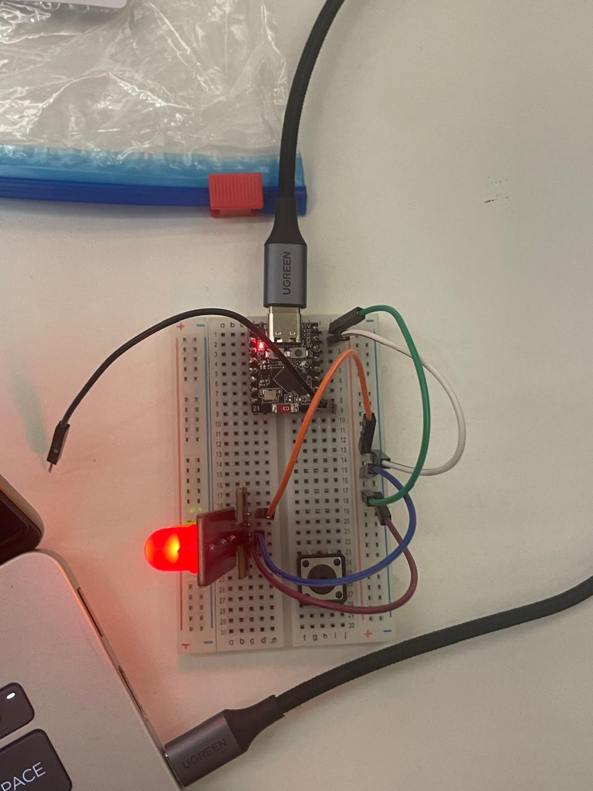

# Lua Hardware Night: a WhatsApp-controlled ESP32

Built at Lua AI Hardware Night, Dublin (October 2026). Text an AI agent on WhatsApp and it drives a real board: "blink the LED 5 times", "what's the temperature?", "set brightness to 30%".



## How it works

```
WhatsApp  ->  Lua agent (pico-agent)  ->  MQTT over WSS  ->  ESP32-C3 SuperMini (MicroPython)
```

The board describes its own commands when it connects. Each one becomes a tool the agent can call, so the agent needs no device code.

| Command | What it does |
|---|---|
| `blink` | Blink the onboard LED (`times`, `interval_ms`) |
| `led_on` / `led_off` | Switch the onboard LED |
| `set_brightness` | LED brightness 0-100 % (PWM) |
| `read_temperature` | Chip's internal temperature in °C |
| `get_status` | Uptime, Wi-Fi signal, IP, free memory |

Pressing the BOOT button fires a `button_pressed` trigger (a handler on the agent side is not written yet).

## Layout

- `firmware/`: MicroPython code for the ESP32-C3 (`main.py`, `config.example.py`)
- `my-gadget/`: the Lua agent project ([lua-cli](https://docs.heylua.ai))

## Run it yourself

1. **Agent**: `npm install -g lua-cli`, then `lua auth configure` (choose Email), and in `my-gadget/` run `npm install`. Use `lua init` to create your own agent instead of reusing the ID in `lua.skill.yaml`.
2. **Device key**: `lua devices credential --device-name my-board --out .env.device`
3. **Board**: flash MicroPython for ESP32-C3 from micropython.org, then
   ```bash
   pip install lua-device-client mpremote
   mpremote mip install umqtt.simple umqtt.robust   # if your firmware lacks umqtt
   mpremote cp <site-packages>/lua_device/micropython.py :lua_device.py
   cp firmware/config.example.py firmware/config.py   # fill in Wi-Fi + the values from .env.device
   mpremote cp firmware/config.py :config.py
   mpremote cp firmware/main.py :main.py
   mpremote reset
   ```
4. **WhatsApp**: message `link-me-to:<your agentId>` to Lua's test number (see [docs](https://docs.heylua.ai/channels/quick-testing)).

`config.py`, `.env.device` and anything holding Wi-Fi passwords or keys are git-ignored.
